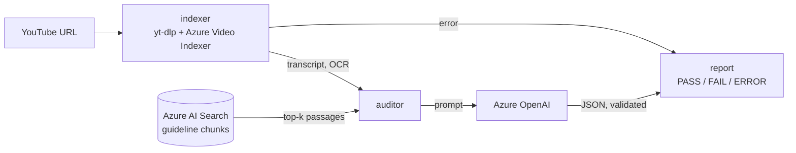

# FrameGuard

Audit a YouTube ad against brand and advertising guidelines and get back a structured list of violations.



The workflow is a two-node LangGraph graph (`backend/src/graph`). The indexer downloads the video, runs it through Video Indexer and keeps the timestamped transcript and on-screen text. The auditor retrieves guideline passages and asks the chat model for a report. Each issue has a category, severity, description, timestamp and a verbatim quote of the guideline it breaks. Model output is validated against a Pydantic schema; anything that does not parse becomes an `ERROR`, not a silent pass.

The guidelines come from the PDFs in `backend/data/`: the FTC's *Disclosures 101 for Social Media Influencers* and a YouTube ad specs guide.

## Setup

```bash
uv sync
cp .env.example .env    # fill in Azure OpenAI, AI Search and Video Indexer values
az login                # Video Indexer uses DefaultAzureCredential
uv run python -m backend.scripts.index_documents   # chunk and upload the guideline PDFs
```

## Run

```bash
uv run uvicorn backend.src.api.server:app --reload
curl -X POST localhost:8000/audit -H 'content-type: application/json' \
     -d '{"video_url": "https://youtu.be/<id>"}'

uv run python main.py https://youtu.be/<id>        # same thing from the command line
```

Set `APPLICATIONINSIGHTS_CONNECTION_STRING` to send traces and logs to Azure Monitor.

Docker:

```bash
docker build -t frameguard .
docker run --env-file .env -p 8000:8000 frameguard
```

## Test

```bash
uv run pytest
uv run ruff check .
```

The tests run offline. Video Indexer, AI Search and the chat model are injected into `create_graph`, and the tests swap in the fakes from `backend/src/services/fakes.py`.

## Eval

```bash
uv run python -m eval.run_eval --offline        # fake components: checks the harness only
uv run python -m eval.run_eval --input-price <usd/1M> --output-price <usd/1M>   # live
```

`eval/cases.jsonl` holds labelled cases: a transcript snippet, OCR lines and the expected violation categories. The script runs every case through the graph and reports per-category precision and recall, groundedness (the share of cited violations whose quote appears in the retrieved guideline text), latency and token usage. Cost is reported only if you pass prices. The offline mode replaces search with keyword overlap and the model with keyword rules, so its numbers only show the harness works. They do not measure audit quality. No live results are published yet.

## Layout

```
backend/
  data/                    guideline PDFs
  scripts/index_documents.py
  src/
    config.py              settings from env / .env
    graph/                 state + report schema, nodes, workflow
    services/              Video Indexer, Azure Search/OpenAI builders, fakes
    api/                   FastAPI server, telemetry
eval/                      cases, offline guideline excerpts, run_eval.py
tests/
main.py                    CLI
```
